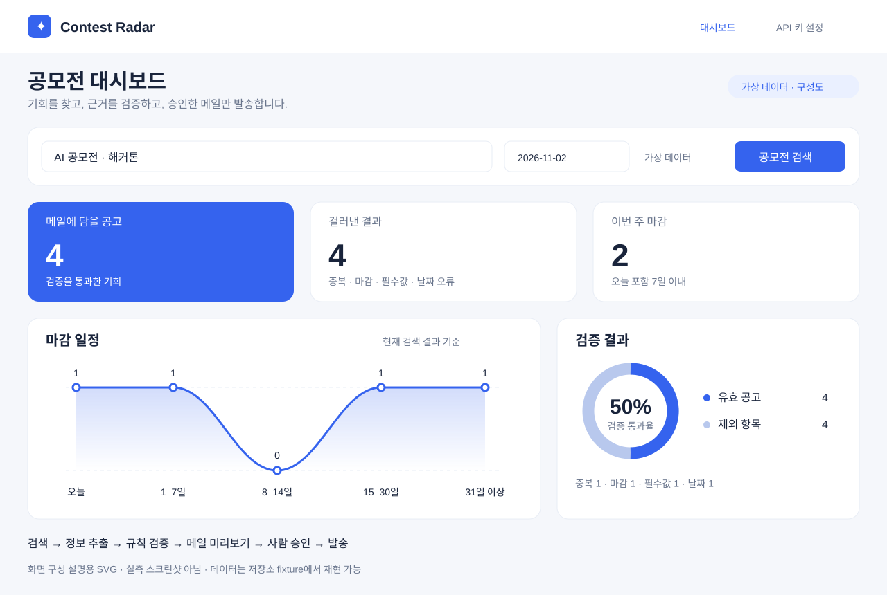
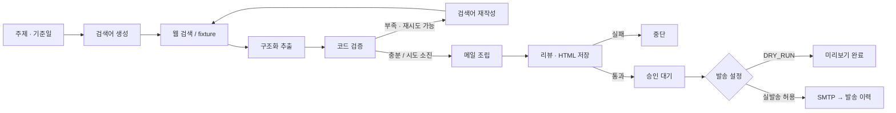

# Contest Radar · AI 공모전 검색 에이전트

[](https://github.com/castle923/Search-Agent/actions/workflows/ci.yml)

**검색 결과를 그대로 보내지 않고, 검증한 공고만 사람이 확인한 뒤 메일로 전달합니다.**

한국의 AI 공모전·해커톤·경진대회를 찾는 로컬 웹/CLI 도구입니다. 여러 사이트에 흩어진 공고의 마감일과 중복을 정리하고, 검색 → 추출 → 검증 → 재검색 → 미리보기 → 승인 과정을 LangGraph로 연결했습니다.



*위 이미지는 fixture 결과를 바탕으로 구성한 대시보드 설명용 렌더입니다. 브라우저 스크린샷이나 실시간 공고가 아닙니다.*

## 해결한 문제

검색에는 지난 대회, 재게시 공고, 날짜가 없는 글과 기사가 섞입니다. LLM이 만든 요약을 바로 발송하면 원문과 다른 날짜·링크가 전달될 수도 있습니다.

이 프로젝트는 언어 처리와 발송 규칙을 분리했습니다. LLM은 검색어와 구조화된 추출을 담당하고, Python 코드는 날짜·URL·중복을 검사하며 검증된 필드로 메일을 조립합니다. 리뷰에 실패하면 발송을 중단하고, 성공해도 기본적으로 승인 직전에 멈춥니다.

- **공고 정리:** 날짜 정규화, 마감 제외, 필수값·HTTP(S) URL 검사, 제목 정규화 기반 중복 제거.
- **근거 연결:** 검색 결과의 URL을 그대로 사용하고, 추출 항목의 `idx`로 출처를 연결합니다.
- **제한된 재검색:** 유효 공고가 부족하면 검색어를 바꿉니다. `MAX_ATTEMPTS`와 그래프 실행 한도로 반복을 제한합니다.
- **검토 가능한 결과:** 마감 임박순 목록, 오늘/D-7 뱃지, 제외 사유, 메일 HTML 미리보기를 제공합니다.
- **명시적 발송:** 기본 `DRY_RUN=1`, CLI 승인 질문 또는 웹의 발송 버튼, 발송 직전 리뷰 게이트를 둡니다.
- **키 없는 재현:** 가상 fixture로 전체 그래프와 평가를 실행할 수 있습니다.

## 실행 흐름

이번 개선에서는 정상 URL의 HTML 이스케이프 오탐을 수정하고, URL 호스트·포트 및 추출 원문 근거 검사를 보강했습니다. 재검색 시 원래 주제를 보존하며, 로컬 API 키 설정과 실제 결과를 집계하는 반응형 대시보드를 추가했습니다. 승인 전후 동작과 화면 집계를 회귀 검사로 남겼습니다.



노드·상태·신뢰 경계는 [아키텍처 문서](docs/ARCHITECTURE.md)에 설명했습니다.

## 빠르게 시작하기

Python **3.12에서 검증한 환경**입니다. 정확한 의존성 버전은 `requirements.lock.txt`에 고정되어 있습니다. Node.js 18 이상은 JavaScript 회귀 검사를 실행할 때만 필요합니다.

저장소를 복제하고 프로젝트 루트에서 실행합니다.

```sh
git clone https://github.com/castle923/Search-Agent.git
cd Search-Agent
```

**Windows · PowerShell**

```powershell
python -m venv .venv-local
.\.venv-local\Scripts\python.exe -m pip install -r requirements.lock.txt
Copy-Item .env.example .env
$env:DRY_RUN = "1"
.\.venv-local\Scripts\python.exe main.py --offline --today 2026-11-02 --auto-send
.\.venv-local\Scripts\python.exe web.py
```

**Linux / macOS · shell**

```sh
python -m venv .venv-local
.venv-local/bin/python -m pip install -r requirements.lock.txt
cp .env.example .env
export DRY_RUN=1
.venv-local/bin/python main.py --offline --today 2026-11-02 --auto-send
.venv-local/bin/python web.py
```

`python`이 Python 3.12를 가리키는지 먼저 확인하세요. 기존 `.env`가 있다면 복사로 덮어쓰지 않고 필요한 항목만 병합합니다. Linux/macOS 명령은 동일한 가상환경 구조를 위한 안내이며 OS별 실행 검증 범위는 별도입니다.

웹 주소는 [http://127.0.0.1:8000](http://127.0.0.1:8000)입니다. **가상 데이터**를 선택하고 기준 날짜를 `2026-11-02`로 바꾸면 같은 fixture를 볼 수 있습니다. 종료는 터미널에서 `Ctrl+C`입니다.

CLI 예시의 `--auto-send`는 승인 질문을 생략합니다. 위 명령은 `DRY_RUN=1`을 명시했으므로 SMTP를 호출하지 않습니다. **`--offline` 자체는 발송을 차단하는 옵션이 아닙니다.**

## 데모에서 확인할 결과

기본 설정과 빈 발송 이력에서 기준일 `2026-11-02`를 사용하면 두 검색 라운드 후 **유효 공고 4건, 제외 4건**이 남습니다. 공고가 아닌 기사 1건은 추출 단계에서 별도로 걸러집니다.

| 확인할 동작 | fixture에서 볼 결과 |
|---|---|
| 재게시 중복 | 같은 공고를 1건만 유지 |
| 지난 마감 · 링크 누락 · 날짜 불명 | 사유와 함께 제외 |
| 마감 임박순 정렬 | 오늘 마감 → 5일 후 → 18일 후 → 43일 후 |
| 대시보드 검증 비율 | 유효 4 / 후보 8 = 50% |
| 메일 출력 | `outbox/mail_2026-11-02.html` 저장, `status=dry_run` |

이 수치는 **가상 입력에 대한 기대 결과**입니다. 검색 품질이나 LLM 정확도 벤치마크를 뜻하지 않습니다. fixture의 기관·공고·`example.com` 링크는 실습용입니다.

## 실제 검색과 메일 설정

`.env.example`을 기준으로 로컬 `.env`를 작성합니다. 저장소에 키나 발송 이력을 추가하지 마세요.

| 설정 | 역할 |
|---|---|
| `TAVILY_API_KEY` | 실제 웹 검색. 없으면 fixture 검색으로 대체 |
| `LLM_PROVIDER`, `LLM_MODEL` | 추출 모델 선택. `none`이면 규칙 기반 대체 |
| `ANTHROPIC_API_KEY` / `GOOGLE_API_KEY` | 선택한 LLM 서비스 인증 |
| `DRY_RUN=1` | 기본값. 실제 메일 발송 차단 |
| `SMTP_HOST`, `SMTP_PORT` | SMTP SSL 서버와 포트, 예시 기본 포트 465 |
| `SMTP_USER`, `SMTP_PASSWORD`, `MAIL_TO` | 발신 계정, 인증 정보, 수신 주소 |
| `MIN_ITEMS`, `MAX_ATTEMPTS`, `TOPIC` | 목표 공고 수, 최대 검색 라운드, 기본 주제 |

lock 파일에는 Anthropic·Gemini 연동이 포함됩니다. OpenAI 분기도 코드에 있지만 `langchain-openai`는 lock에 포함되지 않아 추가 설치가 필요합니다. 모델 이름과 계정 권한은 이용할 제공자에서 확인하고 맞춰 설정하세요.

웹의 **API 키 설정** 화면은 Anthropic 키만 저장합니다. 키는 로컬 `.env`에 평문으로 보관되며, 화면에는 기존 키 값 대신 설정 여부만 표시합니다. 검색 키·메일·다른 제공자 설정은 `.env`에서 관리합니다.

실제 검색은 `.env`를 설정한 후 아래처럼 실행합니다. 다음 명령의 `python`은 설치한 가상환경의 실행 파일을 뜻합니다.

```sh
python main.py --topic "학생 AI 해커톤"
```

처음에는 `DRY_RUN=1`로 결과와 수신 주소를 확인합니다. 실제 발송에는 `DRY_RUN=0`과 SMTP 인증이 필요하며, **CLI 질문에 `y`를 입력하거나 웹에서 메일 발송을 눌러야** 진행됩니다. 앞서 데모용으로 설정한 환경변수 `DRY_RUN=1`은 `.env`보다 우선하므로 변경 시 해당 환경변수도 해제하거나 명시적으로 바꿔야 합니다.

Gmail을 사용할 경우 계정 정책에 맞는 SMTP 인증 수단(예: 앱 비밀번호)을 준비합니다. 실제 외부 검색·LLM 호출은 제공자에게 주제/검색어 또는 검색 본문 일부를 전달하며, 계정별 요금과 한도가 적용될 수 있습니다. 메일 발송은 수신자와 메일 본문을 SMTP 제공자에게 전달합니다.

승인을 생략하는 `--auto-send`는 발송 설정이 활성화되어 있으면 곧바로 전송합니다. 이 저장소는 예약 실행기를 제공하지 않습니다.

## 검증하기

가상환경에서 다음 검사를 실행합니다. Python 평가는 fixture와 mock을 사용하므로 외부 API·SMTP 인증이 필요하지 않습니다.

```sh
python evals/run_evals.py
python -m unittest evals.test_restore evals.test_settings -v
node evals/test_dashboard.cjs
```

- `run_evals.py`: 날짜·중복·추출 매핑·발송 이력·전체 그래프를 확인하고, 검증 없는 기준선과 고정 fixture 결과를 비교합니다.
- `test_restore.py`: 출처 근거, 잘못된 URL, HTML 이스케이프, 승인 전후 SMTP mock, 0건 안내를 검사합니다.
- `test_settings.py`: 임시 파일과 로컬 서버로 설정 저장·잘못된 Origin·토큰 거부·키 비노출을 확인합니다.
- `test_dashboard.cjs`: 차트 집계·빈 상태·비율·NDJSON 파싱·HTTP 오류 처리를 검사합니다. 실제 브라우저 테스트는 아닙니다.

평가 과정에서 `outbox/` 미리보기가 생성될 수 있습니다. 실제 SMTP 전달 성공률과 실시간 검색 정확도는 이 오프라인 검사로 증명하지 않습니다.

공개 준비 시 로컬에서 평가 **19/19**, 회귀 검사 **9/9**, 프론트엔드 self-check가 통과했습니다. [검증 범위와 해석](docs/VALIDATION.md)을 참고하세요. GitHub Actions는 키 없이 동일 검사를 실행합니다.

## 구성과 기술 선택

| 위치 / 기술 | 책임 |
|---|---|
| `agent/graph.py` · LangGraph | 조건부 재검색, 리뷰 분기, 승인 직전 중단 |
| `agent/state.py` · TypedDict | 공고·실행 상태와 누적 결과 정의 |
| `agent/nodes.py` · Pydantic / LangChain 연동 | 구조화 추출과 노드 실행 |
| `agent/rules.py` · Python | 날짜·URL·중복·메일 검증 |
| `agent/tools.py` · Tavily / SMTP SSL | 외부 서비스와 로컬 fixture·파일 입출력 |
| `web.py` · HTTPServer | 로컬 API, NDJSON 진행 이벤트, 승인 재개 |
| `web/` · HTML / CSS / JavaScript / SVG | 반응형 대시보드, 차트, 미리보기 |
| `data/fixtures/`, `evals/` | 재현 가능한 가상 데이터와 검증 하네스 |

별도 프런트엔드 빌드나 벡터 DB는 없습니다. RAG는 이 구현에 포함하지 않았으며, 검색 결과를 현재 실행에서 추출·검증하는 흐름입니다.

## 운영 경계와 출처

- 대상(학생·일반 등)은 표시·검색어에 반영되지만, 별도 엄격한 자격 필터가 아닙니다.
- 검색은 지정 공모전 사이트 중심이며 본문 전체 대신 검색 결과의 텍스트를 사용합니다. 추출 입력은 결과별 앞 800자입니다.
- 출처 가드는 기관명·날짜 원문의 텍스트 포함 여부를 확인합니다. 사실 검증이나 프롬프트 인젝션의 완전한 방어를 보장하지 않습니다.
- 날짜는 일 단위입니다. 연도 없는 날짜는 제한된 추정 규칙을 사용하며 접수 시작일·마감 시각까지 판단하지 않습니다. 신청 전 원문 확인이 필요합니다.
- 실행 상태는 메모리에 있어 서버 재시작 후 승인 대기를 복구하지 못합니다. 발송 이력은 수신자별이 아닌 단일 로컬 파일이며 손상 시 빈 이력으로 취급합니다.
- 같은 기준일의 미리보기 파일은 덮어씁니다. 발송 이력에는 자동 만료·동시 쓰기 제어가 없습니다.
- 웹은 루프백에 바인딩한 단일 사용자용 `HTTPServer`입니다. 설정 저장의 Origin·토큰 검사는 로그인 인증이 아닙니다. 외부 공개·다중 사용자 운영을 위한 인증·TLS·작업 큐는 구현하지 않았습니다.

사용자가 제공한 시작 프로젝트를 기반으로 실행 환경·검증·대시보드를 발전시킨 작업입니다. UI는 전달받은 **V16 스타일 분석**의 밝은 배경, 파란 KPI 카드, 차트와 정보 배치를 참고해 공모전 업무에 맞게 구현했습니다. 원본 UI 코드나 이미지 자산을 복사한 결과로 주장하지 않으며, 전부 독자 창작이라고도 주장하지 않습니다. 별도 라이선스가 명시되지 않은 자료의 재사용 권한을 이 문서가 부여하지 않습니다.
