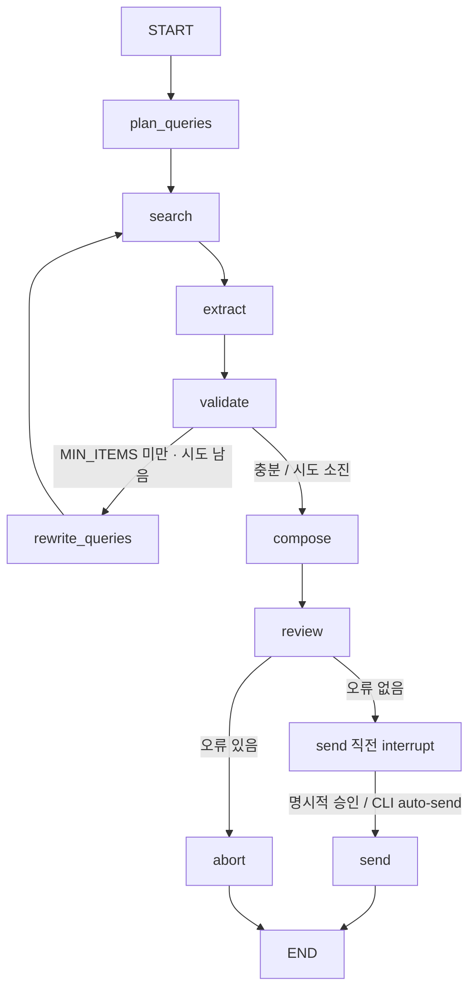

# 아키텍처와 검증 경계

Contest Radar는 검색 결과를 검증 가능한 공고 목록으로 바꾸고, 사람이 확인한 메일만 발송하도록 구성한 로컬 에이전트입니다. CLI와 웹이 동일한 LangGraph를 사용합니다.

## 책임 분리

| 계층 | 파일 | 역할 |
|---|---|---|
| 진입점 | `main.py`, `web.py` | 입력, 기준일, 실행 식별자, 진행 표시, 승인 재개 |
| 흐름 | `agent/graph.py` | 노드 연결, 재검색·리뷰 분기, 체크포인트 |
| 상태 | `agent/state.py` | `Contest`, `AgentState`와 누적 reducer |
| 처리 | `agent/nodes.py` | 검색어 생성, 추출, 검증 호출, 조립, 리뷰, 발송 |
| 규칙 | `agent/rules.py` | 순수 Python으로 날짜·URL·중복·메일 검사 |
| 연동 | `agent/tools.py` | Tavily, 선택 LLM, SMTP, fixture, 로컬 파일 |
| 화면 | `web/index.html`, `web/settings.html` | 검색 폼, 차트, 목록, 미리보기, 키 입력 |

LLM은 비정형 텍스트 처리를 담당합니다. 필수 필드·마감·중복 판정, 메일 링크와 날짜 삽입, 발송 허용 여부는 코드로 처리합니다. LangChain의 제공자 어댑터와 구조화 출력을 사용하며, 별도 RAG·벡터 저장소는 없습니다.

## 그래프와 상태



- `raw_results`와 `log`는 `operator.add`로 누적됩니다. 나머지 상태는 최신 노드 출력으로 갱신합니다.
- `search`는 이전 검색 URL과 중복되는 결과를 건너뜁니다. `extract`는 누적 검색 결과를 다시 처리합니다.
- `validate`는 후보 전체를 유효·제외 목록으로 다시 나눕니다. 기사 등 비공고 판정은 추출 단계에서 별도로 집계됩니다.
- 검색은 1라운드부터 시작합니다. 기본 `MIN_ITEMS=3`, `MAX_ATTEMPTS=2`이고, 호출 측에 `recursion_limit=25`가 설정되어 있습니다.
- 검색 소진 후에도 공고가 0건이면 안내 메일을 조립합니다. 이 메일에도 동일한 리뷰·승인·DRY_RUN 규칙을 적용합니다.
- `MemorySaver`는 프로세스 내 실행 상태를 보관합니다. 승인 전후 같은 실행 식별자를 사용하며, 영구 실행 복구는 제공하지 않습니다.

## 검색과 추출의 신뢰 경계

실제 검색은 `CONTEST_DOMAINS`에 지정한 공모전 사이트로 범위를 제한한 Tavily 검색입니다. `OFFLINE=1`이거나 Tavily 키가 없으면 `data/fixtures/search_results.json`을 읽습니다.

명시적 offline 모드는 LLM도 비활성화합니다. 단, **Tavily 키가 없어서 fixture로 대체되는 것만으로는 LLM이 비활성화되지 않습니다.** 설정된 제공자 키가 있으면 해당 LLM을 호출할 수 있습니다. 외부 호출 없는 데모는 `--offline`을 사용합니다.

LLM 추출 시 각 검색 결과에 번호를 부여하고 결과의 `idx`로 매핑합니다. 출력 순서가 달라져도 다른 공고의 URL을 잘못 붙이지 않도록 하기 위함입니다. 누락된 인덱스는 빈 추출 결과로 처리합니다.

URL과 출처 이름은 검색 결과에서 가져옵니다. LLM이 추출한 기관명과 날짜 원문은 공백을 제거한 검색 본문 앞 800자에 포함되어야 하며, 근거가 없으면 `unsupported_source`로 제외합니다. 제목·대상·분야까지 모두 근거 대조하는 일반 사실 검증기는 아닙니다.

키 없는 대체 추출기는 `주최: … | 대상: … | 접수기간: …` 형식에 맞춘 규칙입니다. 임의의 실시간 검색 문서를 동등하게 처리한다고 보장하지 않습니다. 검색어의 대상 표현 역시 강제 자격 필터는 아닙니다.

## 결정적 검증 규칙

1. 근거 없는 추출(`unsupported_source`)을 먼저 제외합니다.
2. 날짜를 `YYYY-MM-DD`로 정규화합니다. 기간 표기는 마지막 날짜를 사용합니다.
3. 날짜 파싱 실패, 제목·기관·날짜·URL 누락을 사유와 함께 제외합니다.
4. URL의 HTTP(S) 스킴, 호스트, 공백, 포트 형식을 검사합니다. 실제 링크 접속이나 사이트 신뢰성을 검증하는 단계는 아닙니다.
5. 기준일보다 이전 마감 공고를 제외합니다. 기준일 당일은 유효합니다.
6. 정규화한 기관명·제목·마감일로 중복을 제거하고, 발송 이력에 있으면 `already_sent`로 제외합니다.
7. 남은 일수와 뱃지를 채운 뒤 마감 임박순으로 정렬합니다.

연도 없는 날짜는 기본적으로 올해를 사용합니다. 이미 지났고 다음 해 해당 날짜까지 92일 이내인 경우만 다음 해로 해석합니다. 접수 시작 여부와 마감 시각은 검사하지 않습니다.

## 메일과 발송

메일의 공고 블록은 검증된 필드를 HTML 이스케이프해 조립합니다. 선택 LLM은 도입 문장 한 줄만 작성합니다. `review_mail`은 제목 형식, 허용 링크·누락 링크, 유효 공고 재검사, 본문 공고 수, 0건 안내, 알려진 비밀 값의 본문 포함 여부를 확인합니다.

리뷰 단계는 결과 HTML을 `outbox/mail_YYYY-MM-DD.html`에 저장합니다. 같은 날짜의 파일은 덮어씁니다. 리뷰 실패 시 미리보기는 남기되 `abort`로 종료합니다.

기본 그래프는 `send` 직전에 멈춥니다. CLI는 승인 입력으로, 웹은 `/send` 요청으로 재개합니다. CLI `--auto-send`만 승인 중단을 생략합니다. 실제 SMTP 호출 조건은 다음과 같습니다.

```text
리뷰 통과 + 승인(또는 auto-send)
    + DRY_RUN != "1" + SMTP_USER 설정
    → SMTP SSL 인증 · 발송
```

`--offline`은 검색·추출 모드이며 발송 안전장치가 아닙니다. 안전한 데모는 별도로 `DRY_RUN=1`을 명시합니다. SMTP 인증 오류는 호출 오류로 처리되며, 실패를 성공 이력으로 기록하지 않습니다.

공고 키는 SMTP 호출 성공 후에만 `data/sent_history.json`에 합쳐 저장합니다. 이력은 수신자별이 아니며, 파일 손상 시 빈 집합으로 취급합니다. 이력 파일 쓰기 전 프로세스 중단이나 SMTP 성공 후 저장 실패 시 재발송될 수 있어 정확히 한 번 전달을 보장하지 않습니다.

## 로컬 웹과 인증

`web.py`는 `127.0.0.1:8000`의 단일 `HTTPServer`를 실행합니다. `/run`과 `/send`는 NDJSON으로 노드 이벤트와 완료 상태를 전달합니다. 브라우저가 이를 읽어 현재 실행의 차트·목록·미리보기를 갱신합니다. 과거 시계열 분석은 아닙니다.

설정 저장은 로컬 Host·동일 Origin·프로세스별 토큰·요청 크기·폼 필드·키 형식을 검사합니다. 설정 페이지는 기존 비밀 값을 출력하지 않으며 캐시를 비활성화합니다. Anthropic 키만 `.env`와 현재 프로세스 환경에 반영합니다. 키 저장은 계정의 유효성·이용 권한 확인이 아닙니다.

**이 검사는 로그인 인증이 아닙니다.** `/run`·`/send`에 운영용 사용자 인증이 없으며, TLS·다중 사용자 격리·동시 작업 큐도 없습니다. 외부에 포트를 노출하는 배포를 전제로 하지 않습니다. 키는 로컬 파일에 평문 저장되므로 해당 OS 계정의 파일 접근 권한을 신뢰합니다.

## 검증 하네스와 해석

| 검사 | 검증하는 경계 |
|---|---|
| `python evals/run_evals.py` | 규칙 사례, 순서가 바뀐 추출의 URL 매핑, 발송 이력, fixture 전체 그래프와 기준선 비교 |
| `python -m unittest evals.test_restore evals.test_settings -v` | 승인·SMTP mock, 원문 근거, URL·HTML, 빈 결과, 로컬 설정 요청 |
| `node evals/test_dashboard.cjs` | 차트 구간·비율·빈 상태, NDJSON 마지막 줄, HTTP 오류 |

고정 기준일 `2026-11-02`의 기본 fixture 기대 결과는 유효 4건·제외 4건입니다. 비공고 기사 1건은 별도 추출 제외이며 검증 비율의 분모에 포함되지 않습니다. 하네스의 점수는 자체 fixture 기준선 비교이고 일반적인 검색 정확도 평가가 아닙니다.

SMTP는 mock으로 승인 전 미호출·승인 후 호출을 검사합니다. 실서비스 자격 증명, 실제 수신함 도달, 모델별 추출 품질, 제공자 장애 복구, 실제 브라우저 동작 전체를 이 테스트들이 보장하지 않습니다.

## 데이터·비용·출처

명시적 offline 실행은 외부 검색·LLM 호출 없이 재현합니다. 실제 모드에서는 검색어가 검색 제공자에게, 검색 결과 일부가 선택한 LLM 제공자에게 전달됩니다. 실발송 시에는 수신 정보와 본문이 SMTP 제공자에게 전달됩니다. 사용자는 자신의 계정 권한·한도·비용에 맞춰 설정해야 합니다.

사용자가 제공한 시작 코드와 V16 시각 분석을 바탕으로 개선한 프로젝트입니다. 대시보드 자료는 가상 데이터 기반 설명용 렌더이며 실제 서비스 성과의 증거가 아닙니다. 원본 UI 코드·이미지 자산을 복사하지 않았다는 구현 범위와, 모든 구성 요소를 처음부터 독자 창작했다는 주장은 구분합니다. 이 문서는 제3자 자료나 시작 코드의 라이선스 권한을 새로 부여하지 않습니다.
